# Snow Bros. / SemiCom Pandora core for MiSTer

A MiSTer FPGA core for Toaplan's Snow Bros. hardware and SemiCom's boards built on it, all using
Kaneko's Pandora sprite chip (MAME's `kaneko/snowbros.cpp`), built with Quartus Prime 17.0.2 Lite
for the DE10-nano.

## Contents

- [History](#history)
- [Games](#games)
  - [Supported](#supported)
  - [Alternatives](#alternatives)
  - [Out of scope for now](#out-of-scope-for-now)
- [Hardware](#hardware)
  - [Video timing](#video-timing)
  - [Floorplan](#floorplan)
- [Screenshots](#screenshots)
- [Installation](#installation)
- [Controls](#controls)
- [Status](#status)
  - [Todo](#todo)
  - [Resource usage](#resource-usage)
- [AI Attestation](#ai-attestation)
- [Verification](#verification)
- [Acknowledgements](#acknowledgements)
- [Layout](#layout)
- [License](#license)

## History

**`Arcade-Pandora_20261025.rbf`**
- Scandoubler Fx (HQ2x, CRT 25/50/75%) fixed ([#1](https://github.com/ppriest/Arcade-Pandora_MiSTer/issues/1)); button names for Cookie & Bibi 2 and 3 and Toppy & Rappy ([#2](https://github.com/ppriest/Arcade-Pandora_MiSTer/issues/2)).

**`Arcade-Pandora_20261021.rbf`**
- Games on the SnowBros hardware - mostly bootlegs/Korean title by the likes of Semicom who cloned the SnowBros hw.

## Games

The Toaplan board (snowbros, toto) and the SemiCom boards derived from it: one 68000 memory map
with small variants, one screen, the Pandora sprite chip, and two sound boards (Z80 + YM3812, or
Z80 + YM2151 + M6295). SemiCom's protection is either the dumped 87C52 MCU, run on the core, or
MAME's 512-byte `protdata` image copied into work RAM at reset. The largest set is 3.3 MB.

### Supported

Sets with an `.mra` in `releases/`. Every one has run on the DE10-nano to attract mode, and the
author has judged picture and sound against MAME.

| Name | Year | Manufacturer | Board | Notes |
|-|-|-|-|-|
| Snow Bros. - Nick & Tom (set 1) | 1990 | Toaplan | Toaplan | |
| Come Back Toto | 1996 | SoftClub | Toaplan | ROM bit swap at download |
| Final Tetris | 1993 | Jeil Computer System | SemiCom, finalttr | sound board at 3.579545 MHz |
| Hyper Pacman | 1995 | SemiCom | SemiCom, MCU | the dumped 87C52 runs on the core |
| Cookie & Bibi 2 (English, set 1) | 1996 | SemiCom | SemiCom, MCU | |
| Toppy & Rappy | 1996 | SemiCom | SemiCom, protdata | |
| Cookie & Bibi 3 | 1997 | SemiCom | SemiCom, protdata | constant read at 0x200000 |
| Puzzle Break (set 1) | 1997 | SemiCom / Tirano | SemiCom, protdata | background pen 0xC0 |
| Suhoseong (Korea) | 1997 | SemiCom | SemiCom, protdata | its own input layout, one player |
| Twinkle (set 1) | 1997 | SemiCom / Tirano | SemiCom, protdata | |
| New HyperMan (3-in-1 with Cookie & Bibi & HyperMan) (set 1) | 1998 | SemiCom / XESS | SemiCom, protdata | |
| Macheonlu (Korea) | 1999 | SemiCom / AceVer | SemiCom, protdata | |
| Puzzle Express More More (Korea) | 1999 | SemiCom / Exit | SemiCom, protdata | |
| Puzzle Express More More Plus | 1999 | SemiCom / Exit | SemiCom, protdata | |
| Puzzle King (PacMan 2, Tetris, HyperMan 2, Snow Bros.) | 2002 | K1 Soft | SemiCom, 4in1 | ROM bit swap and sound ROM reorder at download |
| Sutjaro Haeyo Deluxe (Korea) | 1996 | SemiCom | SemiCom, protdata | MAME's ROM patch, as `<patch>` in the `.mra`; `MACHINE_NOT_WORKING` in MAME |
| Gwasuwon (Korea) | 1997 | SemiCom / DMD | SemiCom, protdata | as above |
| Puzzle Yutnori (Korea) | 1999 | Nunal | Yutnori | its own map; two M6295 driven as MAME's stand-in for the undumped PIC |

### Alternatives

Clones, in `releases/_alternatives/`, generated from MAME's merged parent zips (each `.mra` also
names the clone's own zip, for split sets). Each image is identical to `ROM_START`'s, on the
parent's board; not yet run on the DE10-nano.

| Name | Parent |
|-|-|
| Snow Bros. - Nick & Tom (set 2, set 3, set 4, Japan, Dooyong license) | snowbros |
| Hyper Pacman (bootleg) | hyperpac, without the MCU |
| Cookie & Bibi 2 (English, set 2) | cookbib2, MCU |
| Cookie & Bibi 2 (English, set 3), (English / Korean) | cookbib2, on the protdata board |
| Puzzle Break (set 2) | pzlbreak |
| Twinkle (set 2) | twinkle |
| New HyperMan (3-in-1 with Cookie & Bibi & HyperMan) (set 2) | 3in1semi |

### Out of scope for now

| MAME description | Why |
|-|-|
| The Winter Bobble, Snow Bros. (Winter Bobble hardware), Honey Doll, Twin Adventure, Multi Game '96, Snow Bros. 3, Ball Boy | bootleg video boards: other sprite formats, an 8bpp background layer, and for Snow Bros. 3 a sound MCU MAME emulates at a high level because it is undumped |

## Hardware

| Chip | Function | Status |
|-|-|-|
| MC68000, 8 MHz (Toaplan) or 12 MHz (SemiCom) | main CPU | TG68K.C, vendored from the KonamiGX core; checked against MAME from restored states |
| Z80, 6 MHz or 4 MHz | sound CPU | T80, vendored from the Fuuki core; checked through the sound boards' chip-write traces |
| YM3812 | Toaplan FM | jtopl2 (jotego); chip writes match MAME |
| YM2151 | SemiCom FM | jt51 (jotego); chip writes match MAME |
| OKI M6295 | SemiCom ADPCM | jt6295 (jotego); commands match MAME |
| PIC (undumped) | yutnori protection and sound control | MAME's high-level stand-in (mamedev/mame#16478) in RTL: the protection reply and a command sequencer in front of two jt6295; sample starts and stops match MAME's |
| 87C52 | hyperpac and cookbib2 protection MCU | jt8052 (jotego), running the dumped program; benched in the DreamWorld core, here checked by hyperpac and cookbib2 running on the board |
| Kaneko Pandora | sprites | written here from `kan_pand.cpp`; a per-line engine fed from the list fixed at vblank, pixel-exact against MAME |

### Video timing

Pixel clock 48 MHz / 9 = 5.333 MHz, 354 dots a line, 262 lines: 15.07 kHz, 57.50 Hz. Visible
256 x 224 (rows 16-239). MAME gives 57.5 Hz and 262 lines (`set_refresh_hz`, `set_size`) but no
dot clock or horizontal total. The 354 dots were chosen to give MAME's rate with MAME's line count
(`docs/HACKS.md`). The PCB notes' 15.68 kHz line rate would mean about 273 lines
(`docs/MAME_KLUDGES.md`).

### Floorplan

The release revision at `3743699`, fitted Oct 25 2026 (`scripts/floorplan.py`; per-block counts in
`docs/floorplan/Pandora_groups.md`):

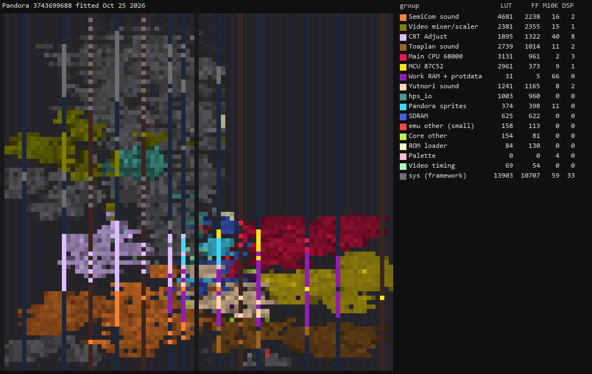

## Screenshots

From the DE10-nano.

**Snow Bros. - Nick & Tom** (`snowbros`)

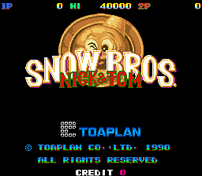 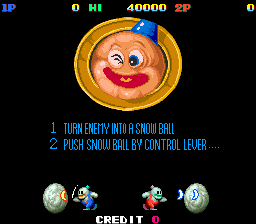 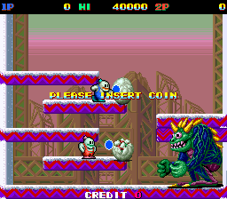

**Come Back Toto** (`toto`)

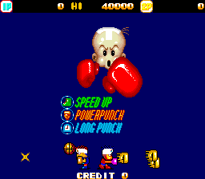 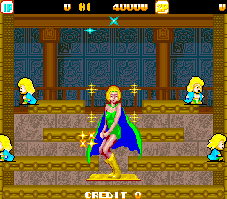

**Final Tetris** (`finalttr`)

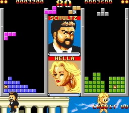 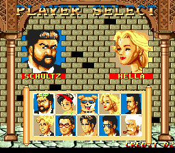

**Hyper Pacman** (`hyperpac`)

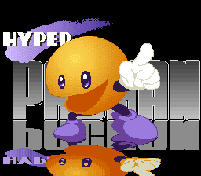 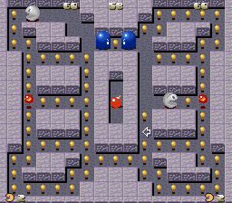

**Cookie & Bibi 2** (`cookbib2`)

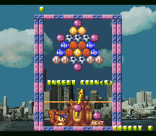 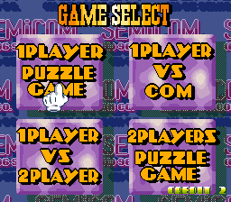

**Toppy & Rappy** (`toppyrap`)

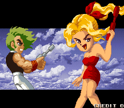 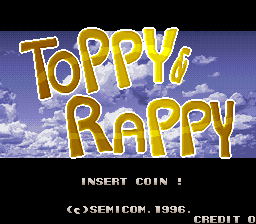 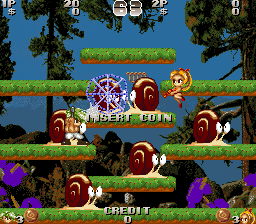

**Cookie & Bibi 3** (`cookbib3`)

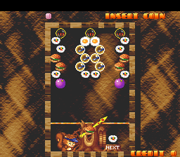 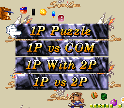 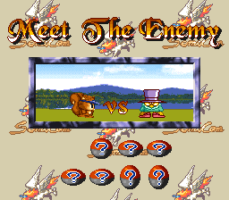 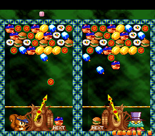

**Puzzle Break** (`pzlbreak`)

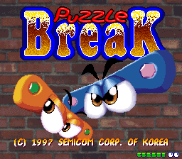 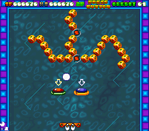

**Suhoseong** (`suhosong`)

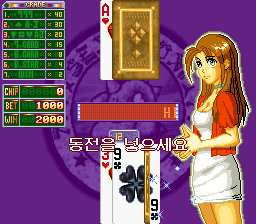

**Twinkle** (`twinkle`)

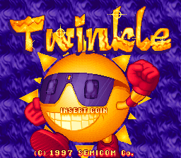 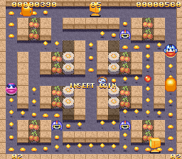

**New HyperMan (3-in-1)** (`3in1semi`)

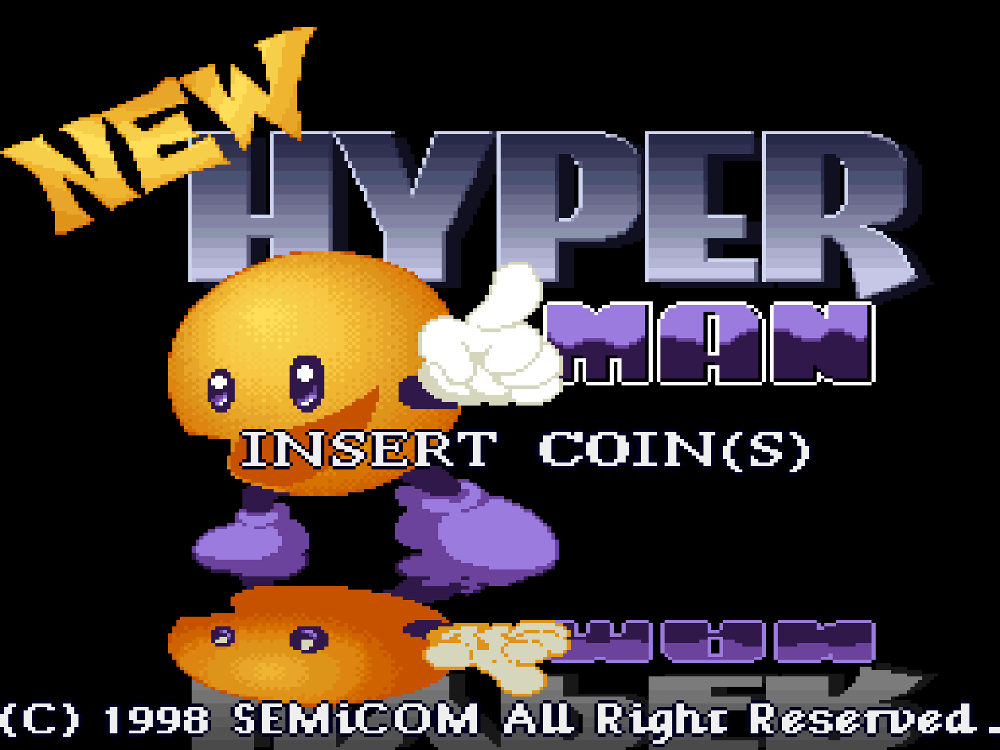 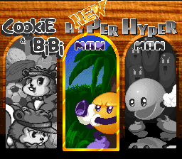

**Macheonlu** (`mcheonru`)

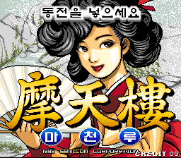 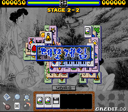

**Puzzle Express More More** (`moremore`)

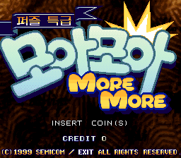 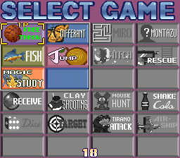 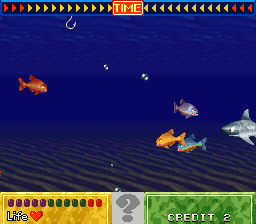

**Puzzle Express More More Plus** (`moremorp`)

 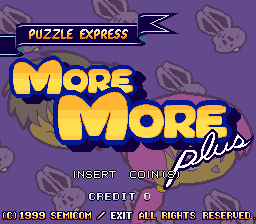

**Puzzle King** (`4in1boot`)

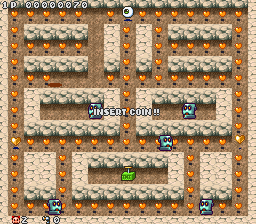 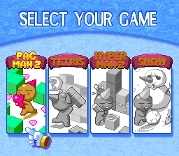 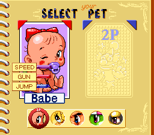

**Sutjaro Haeyo Deluxe** (`sutjarod`)

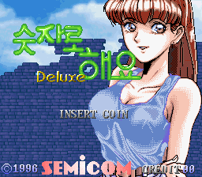 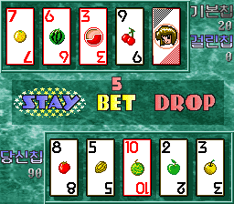

**Gwasuwon** (`gwasu`)

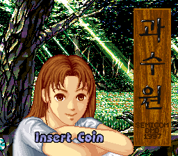 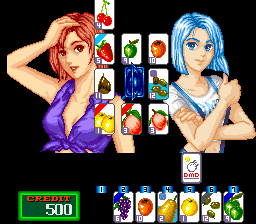

**Puzzle Yutnori** (`yutnori`)

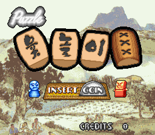 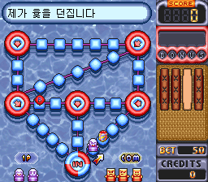

## Installation

An SDRAM module is required (the largest set loads 3.3 MB).

* Take the latest `*.rbf` from `releases/` and put it in `_Arcade/cores`, renamed to drop the
  `Arcade-` prefix (`Arcade-Pandora_YYYYMMDD.rbf` becomes `Pandora_YYYYMMDD.rbf`). The `.mra`
  files name `<rbf>Pandora</rbf>`, not `SnowBros`: MiSTer matches `<rbf>` as a case-insensitive
  prefix, and `SnowBros` would load the Coin-Op Collection's `snowbros_mister` core instead
* Take the `*.mra` files from `releases/` and put them in `_Arcade` (or a subdirectory starting
  with an underscore, e.g. `_Arcade/_Pandora`)
* Put the MAME merged or split ROM sets in `games/mame`. A set whose zip is missing boots to a
  black screen

To run a development build instead: `python scripts/build_staged.py`, then `python scripts/deploy.py`
with a `mister.env` (see `scripts/deploy.py`).

## Controls

The core's joystick buttons are Button 1-6, Start, Coin and Pause. Each `.mra` names the buttons
its game uses:

| Game | Buttons |
|-|-|
| snowbros, toto | Shoot, Jump |
| hyperpac, twinkle | Jump, Fire |
| cookbib2, cookbib3 | Fire, Special |
| toppyrap | Fire, Jump |
| finalttr | Rotate, Rotate Back |
| pzlbreak | Launch |
| 3in1semi, mcheonru, moremore, moremorp, 4in1boot | A, B (compilations; the buttons mean different things per game) |
| suhosong | High, Low, Hit / Double Up, Stand / Take, Bet / Raise; Start is its Button 5 |
| sutjarod, gwasu, yutnori | A, B, C, until named from play |

Keyboard, MAME's defaults: arrows / R F D G, buttons 1-4 LCtrl LAlt Space LShift / A S Q W,
Start 1 / 2, Coin 5 / 6, P pause. suhosong's fifth button is on the pad only.

## Status

Known issues:

* With HDMI Orientation CW or CCW, the CRT 25/50/75% scanlines do not show: the framework draws
  them after the rotator's copy and turns them off while its frame buffer is on
  (`sys/sys_top.v`, `sl_r`). HQ2x works rotated.

`docs/MAME_KLUDGES.md` lists what is taken from MAME as behaviour and what is known not to be
right. `docs/HACKS.md` lists this core's own approximations. `docs/ROADMAP.md` is the plan and its
progress; `docs/LESSONS_LEARNED.md` is what it cost.

### Todo

- [ ] Button names for sutjarod, gwasu and yutnori
- [ ] The bootleg video boards (roadmap, Phases 5b and 5c)
- [ ] Savestates

### Resource usage

Release revision `Pandora` at `3743699`, default seed, on the DE10-nano's Cyclone V 5CSEBA6,
speed grade 7; every clock meets timing, `clk_sys` with +4.031 ns of setup slack, the worst the
HDMI PLL's with +0.672 ns:

| resource | used | available |
| --- | --- | --- |
| Logic (ALMs) | 19,330 | 41,910 |
| Block memory bits | 1,504,522 | 5,662,720 |
| RAM blocks | 241 | 553 |
| DSP blocks | 52 | 112 |
| PLLs | 3 | 6 |

Logic, at 46%, is the most used.

## AI Attestation

This core is being developed with heavy use of a frontier coding assistant, which wrote the code
and the benches under the author's direction. The author made the hardware checks: every set's
picture and sound on the board.

## Verification

Not PCB-validated. MAME is the accuracy reference, with its own acknowledged uncertainties noted
where they matter.

* `.mra` files generated from the driver's `ROM_START`; each set's image, rebuilt from the zips,
  identical to `ROM_START`'s.
* Graphics: the Pandora software model pixel-exact against MAME, 35 of 35 frames of the first
  sets, 33 of 33 frames of the ten later ones and 9 of 9 of sutjarod, gwasu and yutnori; the RTL line engine against the model in
  `sim/video_tb`.
* Download: the SDRAM after the download path, with every ROM transform, against an independent
  Python image, 0 words differ for every set; the `protdata` copy, 0 of 256 words differ.
* 68000, whole core through the SDRAM model: snowbros' boot matches MAME on 12,702 of 12,702
  writes; finalttr's on 12,222 writes, up to an interrupt-timing divergence.
* 68000 from MAME save states: writes and I/O reads match until an interrupt lands at a different
  instruction; five frames on, toppyrap, pzlbreak, moremore, moremorp and 4in1boot hold MAME's
  state but for one counter word.
* Sound: the chip writes against MAME's, in order: snowbros 29,127 of 29,127 (2.85 s), hyperpac
  1,541 of 1,541 (900 ms), finalttr 2,561 of 2,561 (700 ms). yutnori against MAME's voice
  states: 44 of 44 sample starts and 42 of 42 stops over 41 s.

## Acknowledgements

- **Sorgelig** and the **MiSTer-devel team** for the
  [Template_MiSTer](https://github.com/MiSTer-devel/Template_MiSTer) framework and the screen
  rotator.
- The **MAMEdev team**: David Haywood and Mike Coates for `kaneko/snowbros.cpp`, David Haywood
  and Luca Elia for the Pandora (`kaneko/kan_pand.cpp`), and the device emulations that are this
  core's specification.
- **Tobias Gubener** for [TG68K.C](https://github.com/TobiFlex/TG68K.C).
- **Daniel Wallner** and the T80 maintainers for the T80 Z80.
- **Jose Tejada (jotego)** for [jtcores](https://github.com/jotego/jtcores): jtopl, jt51,
  jt6295, jt8052 and the jtframe sprite modules.

## Layout

Standard [Template_MiSTer](https://github.com/MiSTer-devel/Template_MiSTer) structure:

| path | contents |
| - | - |
| `sys` | MiSTer framework, vendored from the template, never edited |
| `rtl` | core source; `rtl/PROVENANCE.md` lists the vendored modules |
| `releases` | `.rbf` and `.mra` files |
| `docs` | roadmap, workflow, release process, kludges, hacks, lessons |
| `sim` | ModelSim and Verilator testbenches |
| `scripts` | build, deploy, capture and verification tooling |
| `debug` | reference captures from MAME used as ground truth (gitignored) |
| `roms` | your own MAME sets (gitignored, never committed) |

## License

GPL-3.0 (see `LICENSE`). Imported components keep their own licences; `rtl/PROVENANCE.md` and
each vendored directory's `PROVENANCE.md` have the detail.

Game ROMs contain copyrighted material and are not included. Obtaining them is your
responsibility.
